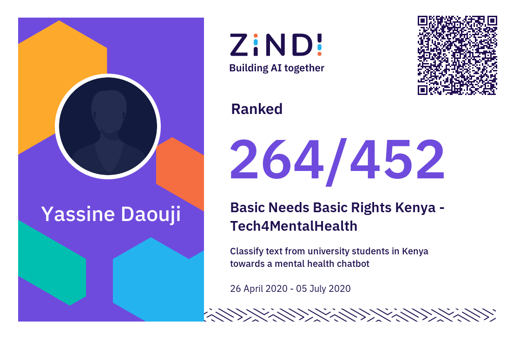

# Tech4MentalHealth — Zindi competition solution

A simple, reproducible NLP baseline for the Zindi
[Basic Needs Basic Rights Kenya — Tech4MentalHealth](https://zindi.africa/competitions/basic-needs-basic-rights-kenya-tech4mentalhealth)
challenge. It classifies short statements from Kenyan university students into
four support categories:

`Depression` · `Alcohol` · `Suicide` · `Drugs`

**Competition result:** ranked **264 / 452**, Certificate of Participation.

<p align="center">
  
</p>

> **Data is not included.** Zindi's competition rules prohibit publishing or
> redistributing the dataset. Download it from the competition page if you are
> an authorised participant. The files must stay out of git.
>
> **Not a medical tool.** This is a research/education project, not a diagnosis
> or crisis-response system.

## Quickstart

Requirements: Python 3.10+.

```bash
python -m venv .venv
source .venv/bin/activate        # Windows: .venv\Scripts\activate
pip install -r requirements.txt
```

Download `Train.csv` and `Test.csv` from the
[competition page](https://zindi.africa/competitions/basic-needs-basic-rights-kenya-tech4mentalhealth)
and place them in `data/`:

```
data/
├── Train.csv
└── Test.csv
```

Train and write a submission:

```bash
python train.py --model svm --cv 5
```

This prints cross-validation metrics and writes
`submissions/submission.csv` with the required columns:

```
ID,Depression,Alcohol,Suicide,Drugs
```

## Results

Five-fold stratified cross-validation on the 616 training rows (seed `42`).
Log loss is the competition metric; lower is better.

| Model | Log loss | Accuracy | Macro F1 |
|---|---:|---:|---:|
| `logreg` | 0.4169 | 0.862 | 0.796 |
| `svm` | **0.4057** | **0.878** | **0.818** |

These are cross-validation scores on a small dataset, not private leaderboard
scores.

## Options

| Flag | Default | Description |
|---|---|---|
| `--model` | `logreg` | `logreg` or calibrated linear `svm`. |
| `--cv` | `5` | CV folds; `0` skips evaluation. |
| `--train`, `--test` | `data/Train.csv`, `data/Test.csv` | Input files. |
| `--output` | `submissions/submission.csv` | Submission path. |
| `--text-col`, `--label-col`, `--id-col` | `text`, `label`, `ID` | Column names. |
| `--classes` | `Depression,Alcohol,Suicide,Drugs` | Class order for the output. |
| `--seed` | `42` | Random seed. |

## Use another dataset

The script is not tied to the competition files or labels:

```bash
python train.py \
  --train my_data/train.csv \
  --test my_data/test.csv \
  --text-col review \
  --label-col sentiment \
  --id-col id \
  --classes negative,neutral,positive \
  --output my_data/submission.csv
```

## How it works

1. Clean the text: keep letters, lowercase, remove English stopwords, and apply
   the Porter stemmer.
2. Extract word TF-IDF features (the SVM also uses character n-grams).
3. Train a class-balanced classifier, evaluate with out-of-fold log loss, then
   refit on all training rows and predict the test set.

## Notebooks

The original competition notebooks are in [`notebooks/`](notebooks):

- [`01_logistic_regression.ipynb`](notebooks/01_logistic_regression.ipynb) —
  EDA, TF-IDF, logistic regression, random forest.
- [`02_svm.ipynb`](notebooks/02_svm.ipynb) — SVM experiment.
- [`03_ann.ipynb`](notebooks/03_ann.ipynb) — Keras ANN experiment (needs
  TensorFlow/Keras).

Their outputs were cleared because they could contain competition text. The
maintained path is `train.py`.

## Notes

- The dataset is imbalanced: 352 Depression, 140 Alcohol, 66 Suicide, and 58
  Drugs examples. Balanced class weights are used, so minority-class recall is
  better than an unweighted model.
- A data audit found 16 duplicate training texts and 13 exact train/test text
  overlaps. The labels are self-reported and were not clinically verified.
- The Suicide class has the lowest recall. Do not use this model for real
  screening or triage without clinical validation, human oversight, and a
  crisis-escalation process.

## License

The code is released under the [MIT License](LICENSE). The competition data is
not included and remains subject to Zindi's rules and the competition host's
rights.
